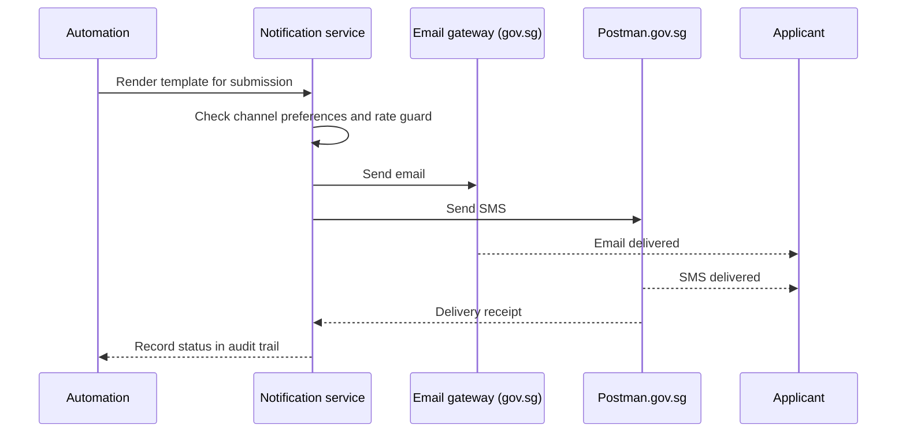

# Notifications

📄 Guide · Updated: 11 Oct 2026 · Freshness: ✅ Current

Notifications keep applicants and officers informed as a submission moves through its lifecycle. They are sent from [automations](workflow-automation.md) and [scheduled actions](scheduled-actions.md), or manually by an officer from the submission view. Every notification is built from a **template** owned by the service.

## Channels

| Channel | Sender | Best for | Limits |
| --- | --- | --- | --- |
| **Email** | `no-reply@apply.gov.sg`, or an agency address on a `.gov.sg` domain verified by your administrator | Confirmations, decisions, anything with attachments | 2 MB of attachments; up to 5 attachments |
| **SMS** | Postman.gov.sg, sender ID `GOVSG` by default or a registered agency sender ID | Time-sensitive nudges, OTP-style references | 160 characters per segment, maximum 3 segments |
| **In-portal** | The applicant's dashboard at <code class="expression">space.vars.portal_url</code> | Status updates, requests for clarification | None, but unread messages do not alert the applicant unless paired with email or SMS |


Email and SMS leave the platform through central government gateways, so they inherit the gateway's anti-spoofing controls. You cannot set an arbitrary sender; only verified `.gov.sg` addresses and Postman sender IDs are accepted.


## Templates and variables

Templates are plain text with `{{ variables }}`. The same template can carry an email subject, an email body, an SMS body and an in-portal body, and each channel may be left blank if not needed.

```
Subject: Your application {{ submission.reference }} has been received

Dear {{ applicant.salutation }} {{ applicant.full_name }},

We received your application for {{ service.name }} on {{ submission.submitted_at | date:"d MMM yyyy" }}.
Your reference is {{ submission.reference }}. Processing normally takes {{ service.sla_days }} working days.

Track your application at {{ portal.status_url }}.

This is an automated message from {{ agency.name }}. Please do not reply.
```

Commonly used variables:

| Variable | Example value |
| --- | --- |
| `{{ submission.reference }}` | `APL-2026-0914-00321` |
| `{{ submission.stage }}` | `Under review` |
| `{{ submission.fee_total \| currency }}` | `S$328.50` |
| `{{ applicant.full_name }}` | `Tan Wei Ling` |
| `{{ officer.display_name }}` | `Licensing Officer` (never a personal name unless the service enables it) |
| `{{ portal.status_url }}` | A signed link to the applicant's status page |
| `{{ agency.name }}` | `Ministry of Manpower` |

Filters such as `| date:"d MMM yyyy"` and `| currency` control formatting. Variables that resolve to an empty value render as empty text, so avoid sentences that only make sense when a field is filled; wrap them in a conditional block (choose **Insert condition** in the template editor) instead.

## Delivery path



Delivery status (queued, sent, delivered, bounced, failed) is shown on the submission's **Communications** tab. Bounced email addresses are flagged on the applicant record so officers can follow up by another channel.

## Rate guidance

Government messaging gateways apply shared quotas, and applicants quickly disregard services that message too often. Follow these limits unless the solution owner has approved an exception:

| Rule | Guidance |
| --- | --- |
| Per submission per day | At most 1 SMS and 2 emails from automations |
| Reminders | No more than 3 reminders per draft, spaced at least 3 days apart |
| Bulk sends | Schedule between 09:00 and 18:00 SGT; the platform defers SMS queued outside 08:00 to 21:00 |
| Service-wide | Sends above 20,000 SMS per day require prior notice to the ApplySG team at <code class="expression">space.vars.support_email</code> |

The platform enforces a **rate guard**: a second SMS to the same recipient within 60 minutes from the same service is held and merged unless the template is marked **Urgent**.


Do not place personal data beyond the applicant's name and reference number in an SMS. SMS content is not encrypted end to end and is visible on lock screens. Point the applicant to the portal for details.


## Testing a template



## Preview with a persona
In the template editor choose **Preview** and select a test persona. All variables are rendered from that persona's data.


## Send a test
Use **Send test to me**. The message goes to your TechPass email and, if you have registered one, your mobile number. Test sends are not recorded against any submission.


## Check all channels
Confirm the SMS body fits within three segments and that the email renders correctly with images disabled, which is the default in many agency mail clients.



<details><summary>Officer notifications</summary>

Officers receive in-portal notifications and a daily digest email by default. Individual officers can opt in to immediate email for assignments and SLA warnings from their profile. Supervisor queues can be configured to receive SLA breach alerts by SMS.

</details>
