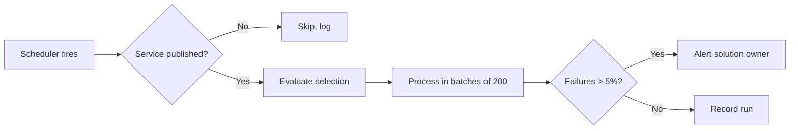

# Scheduled actions

📄 Guide · Updated: 21 Aug 2026 · Freshness: ✅ Current

Scheduled actions are automations that run on a timetable instead of in response to an event. They are the right tool for anything that depends on the passage of time: nudging applicants who have not completed a draft, closing stale cases, or producing a weekly file for a downstream system.

A scheduled action has three parts: a **schedule**, a **selection** of submissions and an **action**.

## Schedule



The schedule picker offers:

- **Daily** at a chosen time
- **Weekly** on chosen days
- **Monthly** on a day of the month, or the last working day
- **Custom** using a cron expression

All times are entered and displayed in Singapore time (SGT, UTC+8). Daylight saving does not apply.


Custom schedules use five-field cron syntax, evaluated in SGT:

```
# minute hour day-of-month month day-of-week
0 2 * * *        # every day at 02:00
30 8 * * 1-5     # weekdays at 08:30
0 6 1 * *        # first day of each month at 06:00
0 18 * * 5       # Fridays at 18:00
```

The minimum interval is 15 minutes. Expressions that would run more often are rejected at save time.




Schedules between 01:00 and 05:00 SGT run in the platform's low-traffic window and are allocated the most capacity. Place heavy jobs, such as full exports, in that window.


## Selection

The selection is a filter over the service's submissions, written in the same expression language as [conditional logic](../logic/conditional-logic.md):

```
stage == "Draft" AND DATEDIFF(TODAY(), submission.updated_at, "days") >= 7
```

Selections are capped at **5,000 submissions per run**. If more match, the job processes the oldest 5,000, records the shortfall and continues on the next run. Raise a request with <code class="expression">space.vars.support_email</code> if a service routinely exceeds this.

## Common patterns

### Nightly draft reminders

| Part | Value |
| --- | --- |
| Schedule | `0 9 * * *` (09:00 SGT, so applicants receive it at a sensible hour) |
| Selection | `stage == "Draft" AND DATEDIFF(TODAY(), submission.updated_at, "days") IN [3, 7, 13]` |
| Action | Send notification `draft_reminder` by email; SMS on day 13 only |

Using a list of specific day counts, rather than `>= 3`, means each applicant receives at most three reminders rather than one every night.

### Auto-close after 30 days

| Part | Value |
| --- | --- |
| Schedule | `0 2 * * *` |
| Selection | `stage == "Draft" AND DATEDIFF(TODAY(), submission.updated_at, "days") >= 30` |
| Action | Move stage to **Closed** with reason `Expired draft`; send notification `draft_expired` |


Auto-close is irreversible for the applicant. Confirm the 30-day window with your service's published terms, and always send a reminder (for example, at day 13 and day 27) before the close runs.


### Recurring export to an agency system

| Part | Value |
| --- | --- |
| Schedule | `0 3 * * 1-6` |
| Selection | `stage IN ["Approved", "Rejected"] AND submission.exported_at IS EMPTY` |
| Action | Export as CSV to the registered SFTP destination; set `exported_at = NOW()` |

Exports use the destinations registered by your agency administrator under **Integrations**. Supported targets are SFTP over the Government intranet, an agency-owned S3-compatible bucket on GCC, and a webhook that receives a signed download link. Column mapping and file naming are described in the [Integrator Guide](https://app.gitbook.com/s/XSPACE_INTEGRATOR/).

## Monitoring

Each scheduled action has a **run history** showing start time, duration, number selected, number succeeded and number failed. A run that fails entirely, or whose failure rate exceeds 5 per cent, raises an automation alert and an email to the solution owner.



## Pausing and testing

- **Pause** a scheduled action from its settings page. Paused actions do not run and do not accumulate missed runs.
- **Dry run** evaluates the selection and reports how many submissions would be affected, without performing the action. Always dry-run a new auto-close rule.
- Scheduled actions in a **draft** version never run. They start on first publication.

<details><summary>What happens if a run overlaps the next schedule?</summary>

A run that is still in progress when its next scheduled time arrives causes the next run to be skipped and logged. Reduce the selection size or move the schedule to the low-traffic window.

</details>
