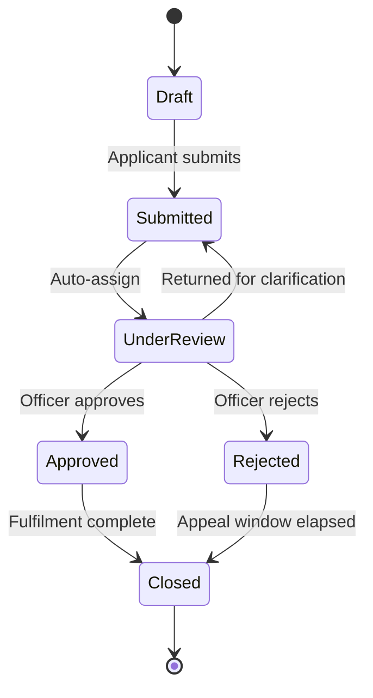

# Workflow automation

📄 Guide · Updated: 30 Sep 2026 · Freshness: ✅ Current

Every service on <code class="expression">space.vars.product_name</code> has a **lifecycle**: the set of stages a submission moves through from the moment an applicant starts a form to the moment the case is closed. Workflow automation lets you attach actions to those transitions so that routine work happens without an officer clicking anything.

## The default lifecycle

You can rename stages, add stages (for example, **Pending payment** or **Site inspection**) and add transitions, but every lifecycle must keep a single **Draft** start stage and at least one **Closed** terminal stage.


Stage names are shown to applicants on their status page. Use plain language ("Under review") rather than internal codes ("UR-2").


## Automation actions

An automation is `WHEN trigger THEN action`. Triggers are stage entries, stage exits, field changes and timers.

| Action | What it does | Typical trigger |
| --- | --- | --- |
| **Assign** | Sets the assigned officer or queue, by rule, round-robin or workload. | Enter **Submitted** |
| **Set field** | Writes a value to an officer-only field, for example `priority = "High"`. | Field change on `fee_total` |
| **Call webhook** | Sends the submission to a registered endpoint and optionally waits for a result. | Enter **Approved** |
| **Send notification** | Sends an email, SMS or in-portal message from a template. See [Notifications](notifications.md). | Any stage entry |
| **Move stage** | Advances the submission to another stage, subject to that stage's guard conditions. | Webhook result, timer |
| **Add note** | Appends a system note to the case history. | Any |

Actions run in the order listed and each action's result is written to the audit trail. A failed webhook does not block the stage change; it raises an **automation alert** on the service dashboard.

## Example: auto-assign and prioritise



## Create the automation
Under **Service settings** choose **Automations** then **New automation**. Name it `Triage on submit`.


## Set the trigger
Choose **Stage entered** and select **Submitted**.


## Add actions
Add **Set field** with `priority = IF(submission.fee_total > 1000, "High", "Normal")`, then **Assign** with mode **Round-robin** over the queue **Licensing officers**, then **Move stage** to **Under review**.


## Test and publish
Use **Run against test submission** to execute the automation on a persona without sending notifications. Publish the draft version when satisfied.



## Guard conditions

A stage can have **guard conditions** that must be true before any transition into it succeeds, whether triggered by an officer or an automation. For example, **Approved** may require `officer.decision_note IS NOT EMPTY` and `submission.payment_status == "Paid"`. A blocked transition shows the officer which guard failed and writes nothing to the submission.

## SLA timers

SLA timers measure how long a submission spends in a stage, or between two stages, against a target you set.

| Setting | Example |
| --- | --- |
| Scope | Stage **Under review** |
| Target | 10 working days |
| Clock | Working days, Singapore public holidays excluded |
| Pause when | Stage is **Submitted** after a return for clarification |
| Warn at | 80 per cent of target |
| Breach action | Notify supervisor queue, set `sla_breached = true` |

Timers appear on the submissions inbox as a coloured badge and feed the median processing time dashboard in [Analytics and reporting](../scale/analytics-and-reporting.md).


A timer's **pause** condition is evaluated on the applicant's side of the process. Time waiting on the applicant is normally excluded from the agency's commitment, but confirm this against your service's published service standard before enabling it.


## Versioning and in-flight submissions

Lifecycle changes take effect only when a version is published. Submissions already in flight continue on the **version they were created under** until they reach a stage that exists in both versions, at which point they migrate. Removing a stage that currently holds submissions is blocked; move or close those submissions first.

Checklist before publishing a lifecycle change

- Every non-terminal stage has at least one outgoing transition.
- Every automation that calls a webhook has a fallback for timeout.
- Guard conditions reference only officer-side or verified fields.
- SLA targets agree with the service standard published on the agency website.
- A test submission has been run through every path, including **Rejected**.

For automations that fire on a schedule rather than an event, see [Scheduled actions](scheduled-actions.md).
