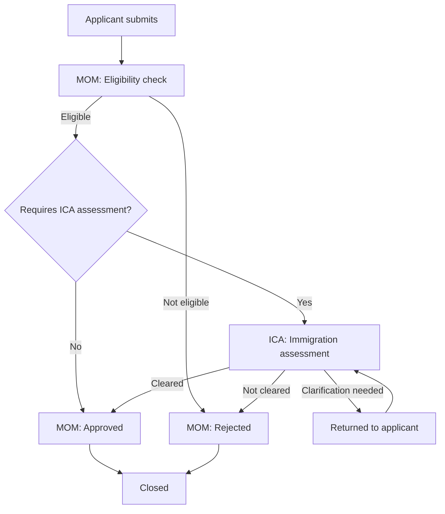

# Multi-agency workflows

📄 Guide · Updated: 03 Oct 2026 · Freshness: ✅ Current

Some services need a decision from more than one agency. A work-related application might be assessed by the Ministry of Manpower (MOM) and then by the Immigration and Checkpoints Authority (ICA), each with its own officers, data and timelines. A multi-agency workflow lets a single submission on <code class="expression">space.vars.product_name</code> move between agencies without the applicant submitting twice and without either agency seeing more than it is entitled to.


The agencies and scenario on this page are illustrative. Real inter-agency services are set up jointly by the participating agencies with the ApplySG team.


## How it works

One agency is the **lead agency** and owns the service, the form and the applicant relationship. Each additional agency is a **participating agency** that owns one or more **shared stages** in the lifecycle. While a submission is in a shared stage, officers from the participating agency can view and act on it under their own TechPass identities, inside their own ApplySG inbox.

The routing decision at **C** is an ordinary [automation](../automation/workflow-automation.md): `WHEN stage entered "Eligibility complete" AND applicant.residency == "Non-resident" THEN move stage "ICA: Immigration assessment"`.

## Setting up a shared stage



## Record the data-sharing agreement
Under **Service settings** choose **Participating agencies** and **Add agency**. Enter the agreement reference, the data owner on each side and the review date. A shared stage cannot be published without an agreement on file.


## Create the stage and assign ownership
Add a lifecycle stage and set **Owning agency** to the participating agency. Officers from that agency are assigned through the queue you specify; the lead agency's officers see the stage but cannot act in it unless given a **Co-reviewer** role.


## Define field visibility
On the **Visibility** tab choose, for each field or section, whether the participating agency can **view**, **edit** or has **no access**. Defaults are **no access**; you add visibility explicitly.


## Agree SLA and notifications
Set the SLA timer for the shared stage and decide which agency's templates are used for applicant notifications. Normally the lead agency sends all applicant-facing messages so the applicant sees one consistent sender.



## Field-level visibility

| Field group | MOM (lead) | ICA (participating) |
| --- | --- | --- |
| Identity (name, FIN, date of birth) | View, edit | View |
| Employment details | View, edit | View |
| Salary and CPF history | View | No access |
| Travel history | No access | View, edit |
| ICA assessment outcome | View | View, edit |
| Internal MOM notes | View, edit | No access |

Visibility is enforced in the officer interface, in exports and in the API. A participating officer who opens a submission sees only the permitted fields; other fields are not merely hidden but are not sent to the browser.


Calculated fields and notification templates inherit the visibility of the fields they reference. A template that mentions `{{ applicant.salary }}` cannot be sent from a stage owned by an agency that has no access to `salary`; the builder blocks publication until the reference is removed.


## Shared stages and the applicant

Applicants see a single status page. Shared stages can be given an **applicant-facing label** that differs from the internal name, so "ICA: Immigration assessment" can appear simply as "Under assessment". Requests for clarification raised by a participating agency are routed through the lead agency's notification templates.

## Audit and accountability

Every action in a shared stage is logged with the officer's agency, so the audit trail can be filtered per agency during a review. Each agency's data protection officer can request an export of the audit log restricted to their agency's actions and the fields their agency could see. See [Data residency and security](data-residency-and-security.md).

Patterns to avoid

- **Copying data to a second service** so the other agency can "have their own form". This creates two records, two sets of applicant communications and no single audit trail.
- **Granting view access to an entire form** for convenience. Agreements are reviewed on the basis of the visibility matrix; keep it minimal.
- **Allowing both agencies to edit the same field.** Nominate one owner per field and let the other agency raise a clarification instead.

For agencies integrating their own case systems with a shared stage, see the [Integrator Guide](https://app.gitbook.com/s/XSPACE_INTEGRATOR/).
