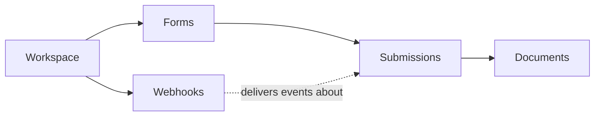

# API Specs

📄 Reference · Updated: 28 Oct 2026 · Freshness: ✅ Current

The ApplySG REST API lets agency systems read form definitions, create and update submissions, retrieve documents and manage webhooks. The reference pages in this section are **generated from the OpenAPI specification** in this repository, so they never drift from what the API actually accepts.

| | |
| --- | --- |
| **Base URL (production)** | <code class="expression">space.vars.api_base_url</code> |
| **Base URL (sandbox)** | <code class="expression">space.vars.sandbox_base_url</code> |
| **Current version** | <code class="expression">space.vars.api_version</code> |
| **Auth** | OAuth 2.0 client credentials, `Authorization: Bearer <token>` |
| **Format** | JSON request and response bodies, UTF-8 |

<table data-view="cards">
  <thead>
    <tr>
      <th width="48"></th>
      <th></th>
      <th></th>
      <th data-hidden data-card-target data-type="content-ref"></th>
    </tr>
  </thead>
  <tbody>
    <tr>
      <td><i class="fa-key"></i></td>
      <td><strong>Authentication</strong></td>
      <td>Get a token and understand scopes.</td>
      <td><a href="guides/authentication.md">authentication</a></td>
    </tr>
    <tr>
      <td><i class="fa-list"></i></td>
      <td><strong>Pagination and filtering</strong></td>
      <td>Cursor pagination and the common query parameters.</td>
      <td><a href="guides/pagination-and-filtering.md">pagination</a></td>
    </tr>
    <tr>
      <td><i class="fa-code-branch"></i></td>
      <td><strong>Versioning</strong></td>
      <td>How date-based versions and deprecations work.</td>
      <td><a href="guides/versioning.md">versioning</a></td>
    </tr>
    <tr>
      <td><i class="fa-book"></i></td>
      <td><strong>Endpoint reference</strong></td>
      <td>Every operation, with a Test it runner.</td>
      <td><a href="reference/README.md">reference</a></td>
    </tr>
  </tbody>
</table>

## Resources at a glance

| Resource | Scope needed | Typical use |
| --- | --- | --- |
| Forms | `forms:read` | Mirror form definitions into an agency system of record |
| Submissions | `submissions:read`, `submissions:write` | Read cases, key in counter submissions, approve from a back-office system |
| Documents | `submissions:read` | Download attachments and generated letters |
| Webhooks | `webhooks:manage` | Subscribe to `submission.*` and `form.*` events |
| Workspace | `forms:read` | Teams and audit events |


Registering an integration, choosing an environment and verifying webhook signatures are covered in the [Integrator Guide](https://app.gitbook.com/s/XSPACE_INTEGRATOR/).

