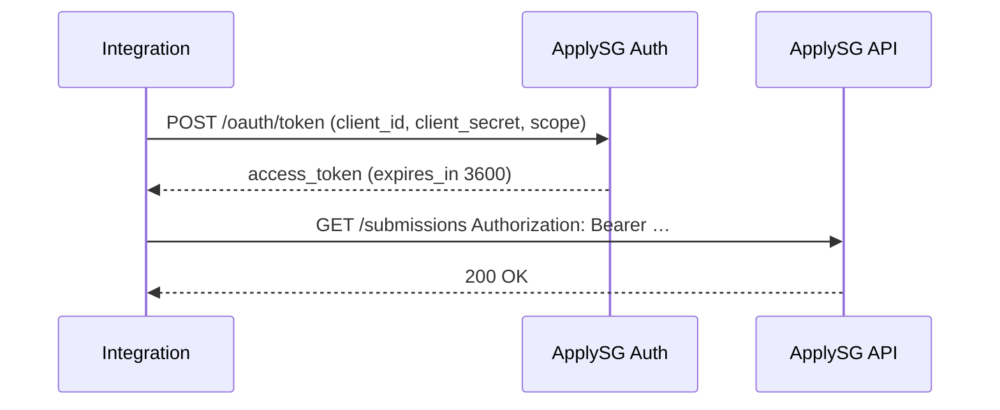

# Authentication

📄 Guide · Updated: 14 Oct 2026 · Freshness: ✅ Current

ApplySG uses **OAuth 2.0 client credentials**. Your integration exchanges its client ID and secret for a short-lived bearer token.



## Request a token



```bash
curl -X POST https://api.sandbox.apply.gov.sg/v1/oauth/token \
  -H "Content-Type: application/x-www-form-urlencoded" \
  -d grant_type=client_credentials \
  -d client_id=asg_client_7f3a9c \
  -d client_secret="$APPLYSG_CLIENT_SECRET" \
  -d scope="forms:read submissions:read"
```



```javascript
const res = await fetch("https://api.sandbox.apply.gov.sg/v1/oauth/token", {
  method: "POST",
  headers: { "Content-Type": "application/x-www-form-urlencoded" },
  body: new URLSearchParams({
    grant_type: "client_credentials",
    client_id: "asg_client_7f3a9c",
    client_secret: process.env.APPLYSG_CLIENT_SECRET,
    scope: "forms:read submissions:read",
  }),
});
const { access_token, expires_in } = await res.json();
```



```python
import os, requests

r = requests.post(
    "https://api.sandbox.apply.gov.sg/v1/oauth/token",
    data={
        "grant_type": "client_credentials",
        "client_id": "asg_client_7f3a9c",
        "client_secret": os.environ["APPLYSG_CLIENT_SECRET"],
        "scope": "forms:read submissions:read",
    },
)
token = r.json()["access_token"]
```



Response:

```json
{
  "access_token": "eyJhbGciOiJSUzI1NiIsImtpZCI6ImFzZy0yMDI2In0...",
  "token_type": "Bearer",
  "expires_in": 3600,
  "scope": "forms:read submissions:read"
}
```

## Scopes

| Scope | Grants |
| --- | --- |
| `forms:read` | List and read forms, versions, workspace and audit events |
| `submissions:read` | List and read submissions and documents |
| `submissions:write` | Create, update and transition submissions |
| `webhooks:manage` | Create, list and delete webhook subscriptions |

Request only the scopes you need; a token carrying a scope the client was not granted is rejected with `scope_insufficient`.


Never embed the client secret in browser or mobile code. Tokens must be minted server-side. Rotate the secret from **Settings → Integrations** if it is ever exposed.


## Token lifetime and caching

Tokens are valid for **3600 seconds**. Cache the token and refresh it when fewer than 60 seconds remain; requesting a new token for every API call counts against your rate limit.
