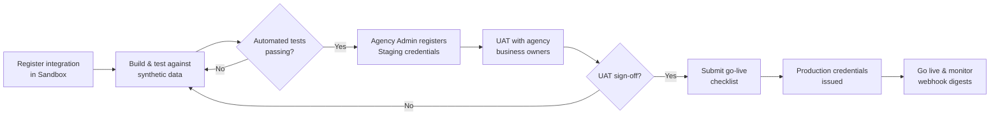

# Environments

📄 Guide · Updated: 02 Oct 2026 · Freshness: ✅ Current

<code class="expression">space.vars.product_name</code> runs three environments. They are fully separate: forms, submissions, credentials and webhook endpoints do not carry over between them, and a token issued in one is never valid in another.

## Overview

| | Sandbox | Staging | Production |
| --- | --- | --- | --- |
| Base URL | <code class="expression">space.vars.sandbox_base_url</code> | `https://api.staging.apply.gov.sg/v1` | <code class="expression">space.vars.api_base_url</code> |
| Purpose | Developer exploration and automated tests | Agency UAT with realistic forms and workflows | Live service |
| Who can access | Any registered developer | Agency UAT team and nominated integrators | Agency and approved integrations only |
| Identity | Test TechPass accounts (`*.test.techpass.gov.sg`) | Agency UAT TechPass accounts | Real TechPass |
| Data retention | **30 days**, then purged automatically | Per agency UAT policy, default 90 days | Per agency records schedule |
| Data classification allowed | Dummy data only, up to Official (Open) | Up to Restricted / Sensitive-Normal | Up to Restricted / Sensitive-Normal |
| Rate limit | 60 requests/min per client | 300 requests/min per client | 600 requests/min per client |
| Webhook delivery | Best effort, no retry SLA | Full retry schedule | Full retry schedule |
| Change freeze | None | Agency-managed | GovTech-managed, announced in the [Changelog](../reference/changelog.md) |


Never load real citizen or officer data into Sandbox. Sandbox is a shared, non-accredited environment and is purged every 30 days without notice. Use the synthetic datasets provided in the Sandbox workspace or generate your own.


## Sandbox

Sandbox is where most integrators spend their first few weeks. It ships with:

* A workspace pre-populated with three example forms (`frm_01HXSANDBOX01` Grant application, `frm_01HXSANDBOX02` Facility booking, `frm_01HXSANDBOX03` Staff declaration) and a four-stage approval workflow.
* Ten test TechPass accounts covering the Requestor, Approver, Admin and Viewer roles.
* A **Webhook tester** page that lets you fire any event at your endpoint on demand.
* Relaxed CORS so you can call the API from `localhost` while developing an embed.

Sandbox forms are reset to their published state on the first day of each month. Submissions you create are retained for 30 days.

## Staging

Staging mirrors Production in behaviour and limits, but points at your agency's UAT TechPass tenant. It is the environment in which the agency's business owners sign off the end-to-end workflow before go-live. Integrators are added to Staging by the agency Admin, not by GovTech.

## Production

Production credentials are only issued once the integration has passed UAT in Staging and the agency has submitted the **Integration go-live checklist** (available in the User Guide). The checklist covers secret storage, webhook endpoint hardening, error alerting and a named support contact.

## Promotion path

## Practical tips

* Keep the base URL, client ID and secret in environment-specific configuration. Hard-coding <code class="expression">space.vars.sandbox_base_url</code> is the most common cause of "works on my machine" tickets we receive.
* Form IDs differ per environment. Resolve forms by their **slug** (`GET /forms?slug=grant-application`) rather than by ID if you want configuration to be portable.
* Point Sandbox webhooks at a disposable endpoint. Anything you register there will stop receiving events when the integration is purged.
