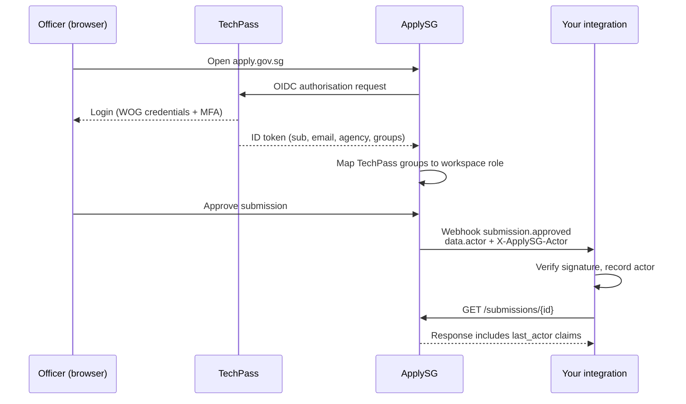

# TechPass single sign-on

📄 Guide · Updated: 30 Sep 2026 · Freshness: ✅ Current

All officer access to <code class="expression">space.vars.product_name</code> is through **TechPass**, the Whole-of-Government identity service for public officers. Integrations never handle TechPass credentials directly. Instead, ApplySG authenticates the officer, establishes their role in the workspace, and passes a signed statement of who acted to your system in webhooks and in certain API responses. This page explains that chain so you can build audit trails and authorisation checks that hold up.

## Roles

| Role | Can | Typical holder |
| --- | --- | --- |
| **Requestor** | Submit forms, view and amend own submissions before lock | Any officer in the agency |
| **Approver** | Act on submissions at stages assigned to them, add comments | Supervisors, directors, finance officers |
| **Admin** | Configure forms, workflows, integrations and roles | Workspace owners in the agency |
| **Viewer** | Read submissions and reports, no actions | Audit, reporting and analytics teams |

Roles are assigned per workspace by an Admin, and can be scoped to a form or an organisational unit. They are enforced by ApplySG, not by your integration; your integration only needs to *record* who did what.

## Identity flow



## The actor claims

When an action is performed by an officer, ApplySG attaches an **actor** object to the resulting webhook event and sets the `X-ApplySG-Actor` header on the delivery. The header is a compact JWS signed with the same keys as access tokens (`{base_url}/.well-known/jwks.json`) so it can be verified independently of the webhook signature.

Decoded, it carries:

```json
{
  "iss": "https://apply.gov.sg",
  "sub": "tp_4a81c2",
  "email": "tan_wei_ling@agency.gov.sg",
  "name": "Tan Wei Ling",
  "agency": "AGY",
  "role": "Approver",
  "workspace_id": "ws_agy_licensing",
  "act": "submission.approved",
  "iat": 1761275561,
  "exp": 1761279161
}
```

* `sub` is the stable TechPass identifier. Use it, not the email, as the key in your own records. Emails change when officers move post.
* `role` is the role at the moment of the action, which may differ from the officer's role today.
* The token is valid for one hour and is intended for verification at receipt, not for storage as a credential.


`X-ApplySG-Actor` tells you **who acted in ApplySG**. It does not authorise that officer to do anything in your system. If your system needs to apply its own permissions, map `sub` to your own user directory and apply your own rules.


## Service account actions

Calls made with an integration's own token have no officer behind them. In that case `data.actor.type` is `integration` and `X-ApplySG-Actor` is omitted. Keep your audit trail honest by recording both kinds of actor distinctly.

## Acting on behalf of an officer

Some agencies need an integration to create or advance submissions as a specific officer, for example when an internal portal collects the data and ApplySG runs the approvals. Request the **delegated actions** feature for your integration from <code class="expression">space.vars.support_email</code>. Once enabled:

1. Your integration includes `X-ApplySG-On-Behalf-Of: tp_4a81c2` on write requests.
2. ApplySG checks that the officer holds a role permitting the action and that your integration is allowed to delegate for that officer's organisational unit.
3. The action is recorded with `actor.type: "delegated"`, naming both the officer and the integration.

Delegated actions are covered in more depth in [Advanced Capabilities](https://app.gitbook.com/s/XSPACE_ADVANCED/).

<details>
<summary>Testing identity in Sandbox</summary>

Sandbox provides ten test TechPass accounts on the `test.techpass.gov.sg` domain, two per role plus two unassigned. Their `sub` values are fixed (`tp_test_requestor_1`, `tp_test_approver_1` and so on) so you can write deterministic tests. Staging uses your agency's UAT TechPass tenant and real `sub` values.

</details>
