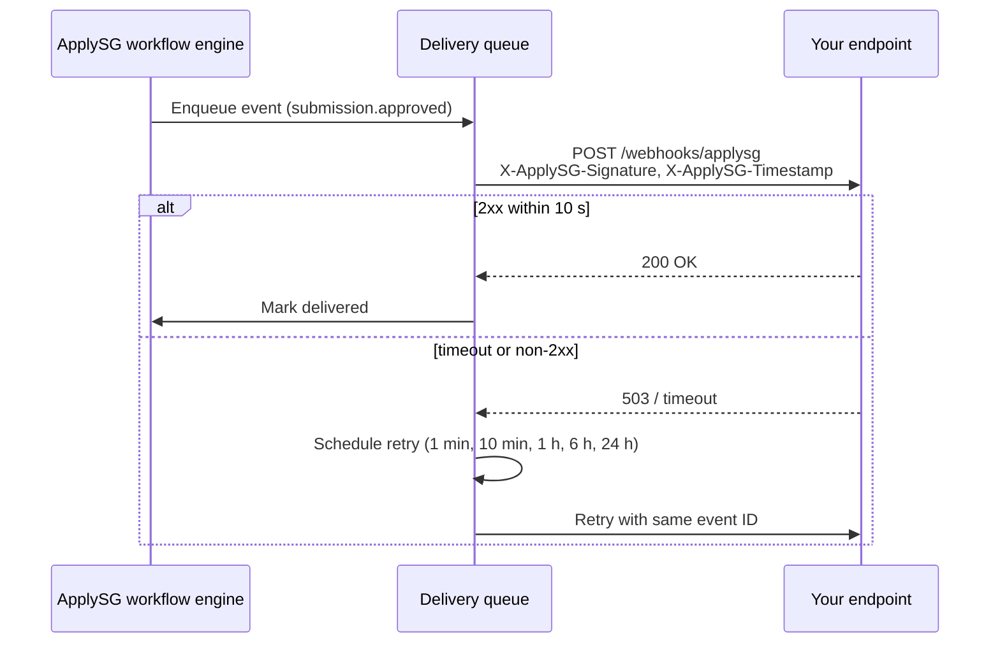

# Webhooks

📄 Guide · Updated: 24 Oct 2026 · Freshness: ✅ Current

Webhooks push events from <code class="expression">space.vars.product_name</code> to an HTTPS endpoint you operate. They are the recommended way to keep an agency case-management system, CRM or data store in step with ApplySG without polling. Managing webhooks requires the `webhooks:manage` scope; receiving them requires nothing more than a public HTTPS endpoint (or a GCC-reachable one for intranet integrations).

## Events

| Event | Fired when | Typical use |
| --- | --- | --- |
| `submission.created` | A requestor submits a form | Create a case record |
| `submission.stage_changed` | A submission moves to a new lifecycle stage | Update case status, trigger SLA timers |
| `submission.approved` | The final approval stage completes | Issue a licence, permit or payment |
| `submission.rejected` | An approver rejects at any stage | Notify requestor through agency channels |
| `form.published` | A new version of a form is published | Refresh cached form definitions |

## Delivery flow



## Retry schedule

ApplySG makes up to **5 attempts** per event with exponential backoff: roughly 1 minute, 10 minutes, 1 hour, 6 hours and 24 hours after the first failure. An attempt succeeds on any `2xx` response received within 10 seconds. After the fifth failure the event is parked, the technical contact receives a failure digest, and the event can be replayed from **Settings → Integrations → Webhooks → Failed deliveries** for 14 days.


Deliveries are **at-least-once** and may arrive out of order. Use the `id` field to de-duplicate and the `occurred_at` timestamp, not arrival time, to order events.


## Example payload

```json
{
  "id": "evt_01HXQ6Z4Y8MN2C7R9T3V5B1KDA",
  "type": "submission.stage_changed",
  "api_version": "2026-10",
  "occurred_at": "2026-10-24T03:12:41Z",
  "workspace_id": "ws_mnd_licensing",
  "data": {
    "submission_id": "sub_01HXQ6Z1R2P7K4W9E3M8N5T0CV",
    "form_id": "frm_01HXK2D8P6M4R1S7Q9W3E5T2AB",
    "form_slug": "grant-application",
    "previous_stage": "officer_review",
    "current_stage": "director_approval",
    "actor": {
      "type": "officer",
      "techpass_id": "tp_4a81c2",
      "role": "Approver"
    }
  }
}
```

## Verifying signatures

Every delivery carries two headers:

* `X-ApplySG-Timestamp`: Unix seconds when the delivery was signed.
* `X-ApplySG-Signature`: `v1=` followed by a hex HMAC-SHA256 of `{timestamp}.{raw_body}` using your endpoint's signing secret (shown once when the endpoint is created).

Reject deliveries whose timestamp is more than five minutes old, and compare signatures with a constant-time function.



```bash
# Recompute the signature for a saved delivery
TS="1761275561"
BODY="$(cat delivery.json)"
printf 'v1=%s\n' "$(printf '%s.%s' "$TS" "$BODY" \
  | openssl dgst -sha256 -hmac "$APPLYSG_WEBHOOK_SECRET" | awk '{print $2}')"
```



```javascript
import crypto from 'node:crypto';

export function verify(req, rawBody) {
  const ts = req.headers['x-applysg-timestamp'];
  const sig = req.headers['x-applysg-signature'];
  if (Math.abs(Date.now() / 1000 - Number(ts)) > 300) return false;

  const expected = 'v1=' + crypto
    .createHmac('sha256', process.env.APPLYSG_WEBHOOK_SECRET)
    .update(`${ts}.${rawBody}`)
    .digest('hex');

  return crypto.timingSafeEqual(Buffer.from(sig), Buffer.from(expected));
}
```



```python
import hmac, hashlib, os, time

def verify(headers: dict, raw_body: bytes) -> bool:
    ts = headers["X-ApplySG-Timestamp"]
    sig = headers["X-ApplySG-Signature"]
    if abs(time.time() - int(ts)) > 300:
        return False
    expected = "v1=" + hmac.new(
        os.environ["APPLYSG_WEBHOOK_SECRET"].encode(),
        f"{ts}.".encode() + raw_body,
        hashlib.sha256,
    ).hexdigest()
    return hmac.compare_digest(sig, expected)
```



## Registering an endpoint

```bash
curl -X POST "https://api.sandbox.apply.gov.sg/v1/webhooks" \
  -H "Authorization: Bearer ${ACCESS_TOKEN}" \
  -H "Content-Type: application/json" \
  -d '{
    "url": "https://licensing.agency.gov.sg/webhooks/applysg",
    "events": ["submission.created", "submission.approved"],
    "description": "Licensing CRM sync"
  }'
```

The response includes the endpoint `id` and a one-time `signing_secret`. Use `POST /webhooks/{id}/test` to send a synthetic `submission.created` event.


Return `200` as soon as you have durably queued the event, then process it asynchronously. Endpoints that do heavy work inline are the main cause of timeouts we see in failure digests.

