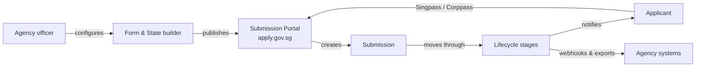

# ApplySG User Guide

📄 Overview · Updated: 28 Oct 2026 · Freshness: ✅ Current

<code class="expression">space.vars.product_name</code> packages a no-code **Form & State builder** with a **Submission Portal**, so an agency can launch a licence application, grant request or feedback process in days rather than months. Officers configure forms, lifecycle stages and approvals in the builder; members of the public and businesses submit through <code class="expression">space.vars.portal_url</code> with Singpass or Corppass.


This guide is written for agency officers who **configure and operate** workflows. If you are a developer connecting an agency system to ApplySG, start with the [Integrator Guide](https://app.gitbook.com/s/XSPACE_INTEGRATOR/) instead.


## Choose your path

<table data-view="cards">
  <thead>
    <tr>
      <th width="48"></th>
      <th></th>
      <th></th>
      <th data-hidden data-card-target data-type="content-ref"></th>
    </tr>
  </thead>
  <tbody>
    <tr>
      <td><i class="fa-rocket"></i></td>
      <td><strong>Get Started</strong></td>
      <td>Create and publish your first form-based workflow in under an hour.</td>
      <td><a href="getting-started/get-started.md">get-started</a></td>
    </tr>
    <tr>
      <td><i class="fa-folder-open"></i></td>
      <td><strong>Access and Permissions</strong></td>
      <td>Workspaces, roles and how TechPass identities map to ApplySG.</td>
      <td><a href="core-features/access-and-permissions.md">access-and-permissions</a></td>
    </tr>
    <tr>
      <td><i class="fa-arrows-rotate"></i></td>
      <td><strong>Building your Lifecycle</strong></td>
      <td>Design the stages a submission moves through, from Draft to Closed.</td>
      <td><a href="core-features/building-your-lifecycle.md">building-your-lifecycle</a></td>
    </tr>
    <tr>
      <td><i class="fa-chart-column"></i></td>
      <td><strong>Documents and Data</strong></td>
      <td>Attachments, generated letters, exports and retention.</td>
      <td><a href="core-features/documents-and-data.md">documents-and-data</a></td>
    </tr>
    <tr>
      <td><i class="fa-dollar-sign"></i></td>
      <td><strong>Pricing and Billing</strong></td>
      <td>What ApplySG costs an agency and how usage is metered.</td>
      <td><a href="reference/pricing-and-billing.md">pricing-and-billing</a></td>
    </tr>
    <tr>
      <td><i class="fa-life-ring"></i></td>
      <td><strong>Getting Help</strong></td>
      <td>Support channels, office hours and the ApplySG community.</td>
      <td><a href="reference/getting-help.md">getting-help</a></td>
    </tr>
  </tbody>
</table>

## How ApplySG fits together

| Component | Who uses it | What it does |
| --- | --- | --- |
| Form & State builder | Agency officers (Requestor, Admin) | Drag-and-drop form design, lifecycle stages, validation and automation |
| Submission Portal | Public and business applicants | Hosted at <code class="expression">space.vars.portal_url</code>, Singpass and Corppass sign-in, save-and-resume |
| Case console | Agency officers (Approver, Viewer) | Review, approve, request clarification, generate letters |
| Integrations | Agency developers | Webhooks, embeds, exports and the REST API (see [API Specs](https://app.gitbook.com/s/XSPACE_API/)) |

## Other documentation sets

* [Integrator Guide](https://app.gitbook.com/s/XSPACE_INTEGRATOR/) — connect agency systems with webhooks, embeds and SSO.
* [API Specs](https://app.gitbook.com/s/XSPACE_API/) — the REST reference, generated from the OpenAPI specification.
* [Advanced Capabilities](https://app.gitbook.com/s/XSPACE_ADVANCED/) — conditional logic, automation, analytics and multi-agency workflows.


Questions? Email <code class="expression">space.vars.support_email</code> or ask the assistant on any page of this site.

