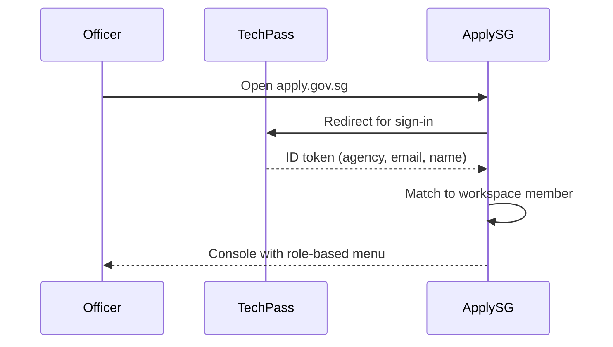

# Access and Permissions

📄 Guide · Updated: 7 Oct 2026 · Freshness: ✅ Current

Every agency gets one **workspace**. Inside it, people hold a **role** and may belong to **teams** that are assigned work at particular lifecycle stages.

## Identity

Officers sign in with **TechPass**. ApplySG reads the agency, email and display name from the TechPass token; it never stores passwords. When an officer leaves the service, TechPass de-provisioning removes their access within 15 minutes.



## Roles

| Role | Typical holder | Permissions |
| --- | --- | --- |
| **Viewer** | Auditors, management | Read submissions and dashboards |
| **Requestor** | Service designers, ops officers | Build and preview forms, raise publish requests, process submissions |
| **Approver** | Licensing or grants officers | Process submissions at stages assigned to their team |
| **Admin** | Digital service owner | Everything, plus publishing, members, integrations and billing |


Keep the number of Admins small (two or three per workspace). Admins can publish forms that collect personal data and can create integration credentials.


## Teams

Teams group officers so that lifecycle stages can be assigned to a team rather than an individual.



## Create a team

Go to **Settings → Teams → New team**, name it (for example `Licensing officers`) and add members.



## Assign the team to a stage

Open a form, select **Lifecycle**, pick a stage and set **Assignee** to the team. New submissions entering that stage appear in every team member's queue.



## Optional: round-robin

Enable **Auto-assign** on the stage to distribute cases evenly across the team.



## Field-level visibility

Sensitive fields (for example a medical declaration) can be restricted so only specific teams see their values. Other officers see a `•••• restricted` placeholder and the audit log records every reveal.



Select the field → **Advanced** → **Visible to** → choose teams.



```json
{
  "id": "medical_declaration",
  "type": "textarea",
  "visibility": {
    "teams": ["team_medical_review"]
  }
}
```



## Audit log

All permission changes, reveals of restricted fields and publish actions are written to the workspace audit log, retained for **7 years** and exportable as CSV. See [Documents and Data](documents-and-data.md).
