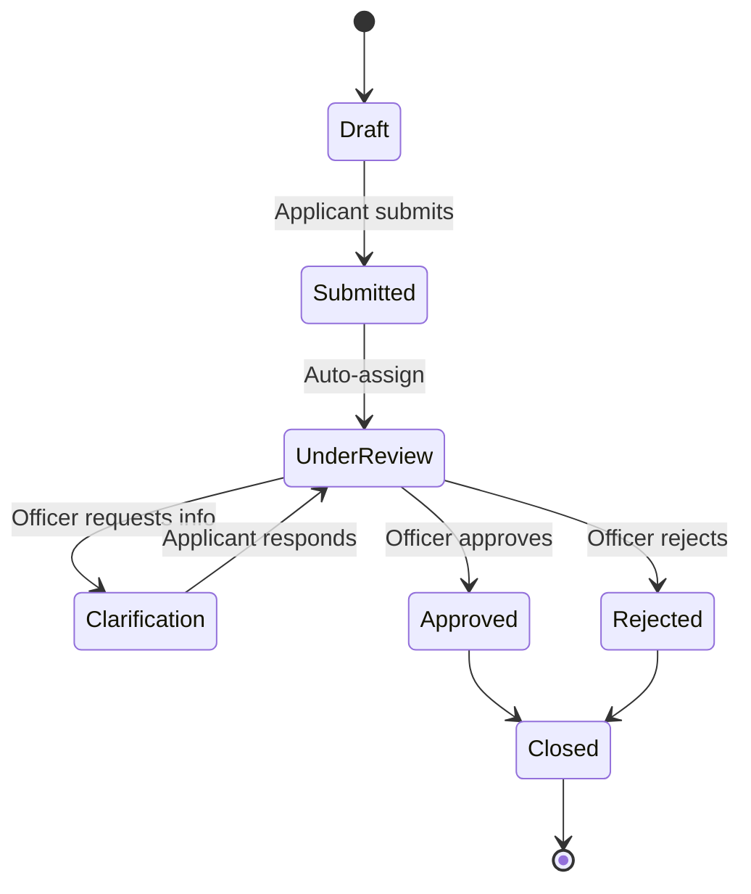

# Building your Lifecycle

📄 Guide · Updated: 21 Oct 2026 · Freshness: ✅ Current

A **lifecycle** is the state machine every submission of a form follows. ApplySG ships with a default lifecycle that suits most approval processes; you can rename, add or remove stages per form.

## The default lifecycle

## Anatomy of a stage

| Setting | What it controls |
| --- | --- |
| **Name** | Shown to officers and, if *Visible to applicant* is on, to applicants |
| **Assignee** | A team or individual whose queue receives the case |
| **SLA** | Working days allowed before the case is flagged as overdue |
| **Actions** | The buttons an officer sees: Approve, Reject, Request clarification, custom |
| **Transitions** | Which stage each action moves the case to |
| **Automations** | Things that happen on entry or exit: notify, set field, call webhook |

## Add a stage



## Open the lifecycle editor

In the form, choose the **Lifecycle** tab. Stages are shown left to right.



## Insert a stage

Hover between *Under review* and *Approved* and select **+**. Name it `Site inspection`.



## Wire the transitions

On *Under review*, add an action **Schedule inspection** that transitions to *Site inspection*. On *Site inspection*, add **Inspection passed** → *Approved* and **Inspection failed** → *Rejected*.



## Set the SLA and assignee

Assign the `Inspectors` team and a 10 working-day SLA.



## Save a version

Select **Save**. Lifecycle changes apply to **new** submissions only; in-flight cases keep the lifecycle version they started on.




SLAs count **Singapore working days** and skip gazetted public holidays automatically.


## Applicant-visible status

Each stage has an optional **Public label**. Applicants see this label on their submission at <code class="expression">space.vars.portal_url</code> and in notification messages, so keep it plain: *Being processed*, *We need more information*, *Approved*.

## Going further

* Trigger actions automatically on transitions with [Workflow automation](https://app.gitbook.com/s/XSPACE_ADVANCED/automation/workflow-automation).
* Route a case across agencies with [Multi-agency workflows](https://app.gitbook.com/s/XSPACE_ADVANCED/scale/multi-agency-workflows).
* Receive `submission.stage_changed` events in your own system via [Webhooks](https://app.gitbook.com/s/XSPACE_INTEGRATOR/patterns/webhooks).
